# Gallery

Pick a button to show one set of images.

<is-land on:visible>

  

    <button @click="active = 'all'" :class="{ on: active === 'all' }" :aria-pressed="active === 'all'">All</button>
    <button @click="active = 'setup'" :class="{ on: active === 'setup' }" :aria-pressed="active === 'setup'">Setup</button>
    <button @click="active = 'cat'" :class="{ on: active === 'cat' }" :aria-pressed="active === 'cat'">Cat</button>
    <button @click="active = 'v'" :class="{ on: active === 'v' }" :aria-pressed="active === 'v'">V</button>
    <button @click="active = 'kojima'" :class="{ on: active === 'kojima' }" :aria-pressed="active === 'kojima'">Kojima</button>
  

  <section class="topic" v-show="active === 'all' || active === 'setup'">
    <h3>Setup</h3>
    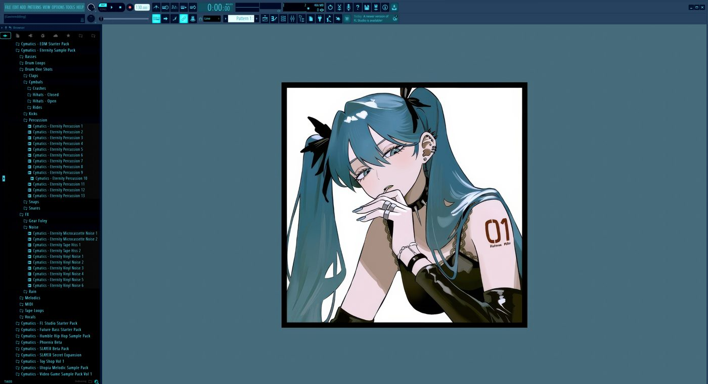
    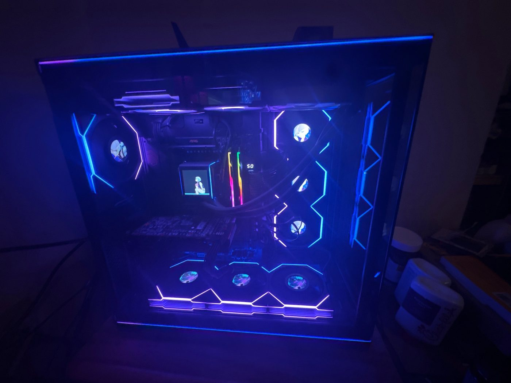
  </section>
  <section class="topic" v-show="active === 'all' || active === 'cat'">
    <h3>Cat</h3>
    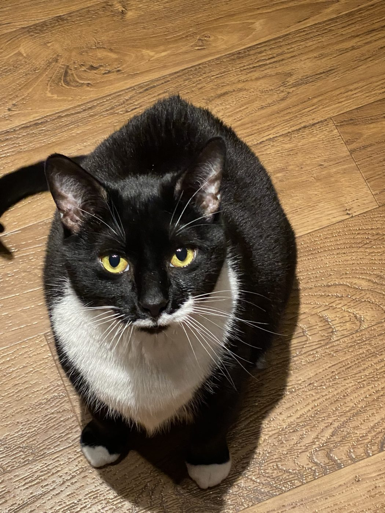
    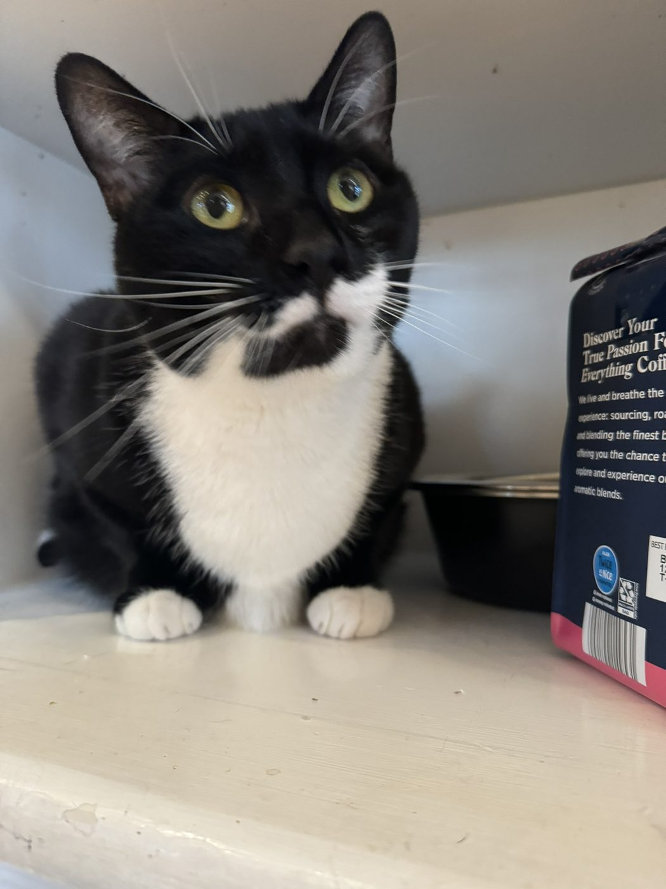
    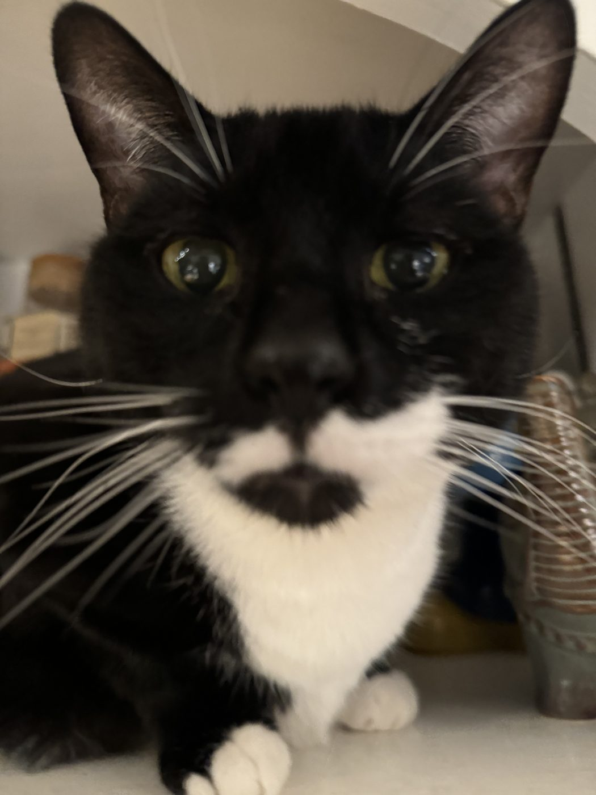
    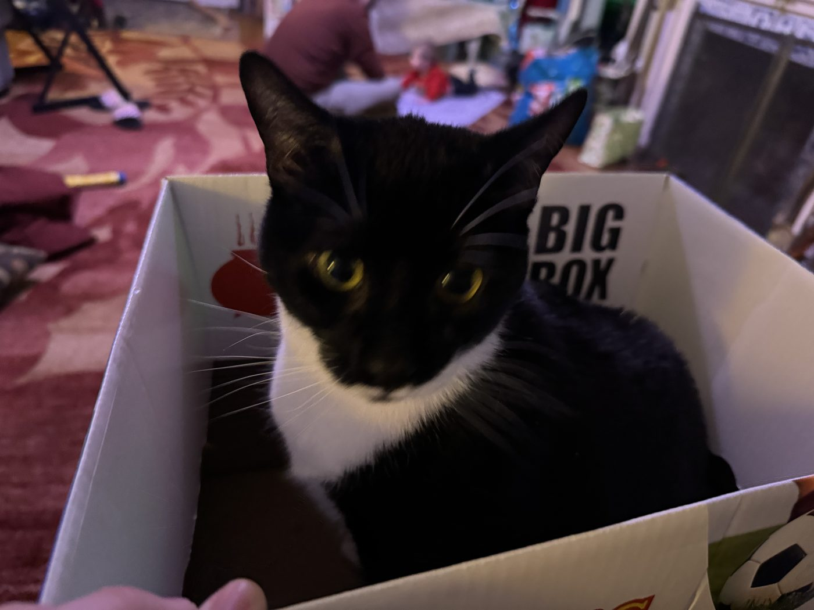
    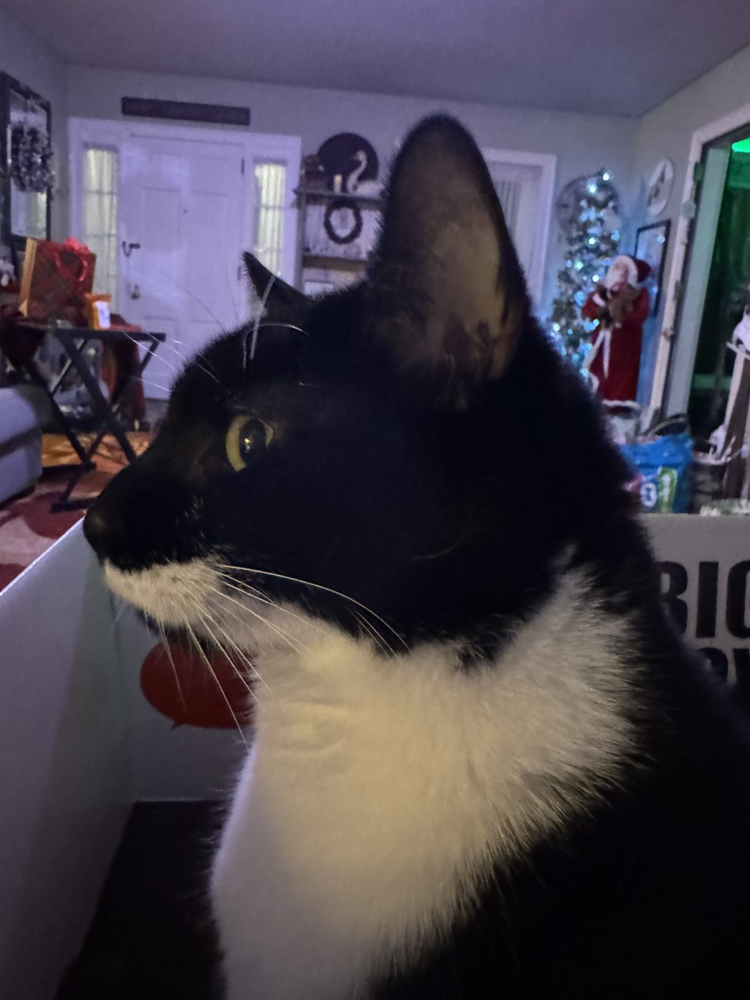
  </section>
  <section class="topic" v-show="active === 'all' || active === 'v'">
    <h3>V</h3>
    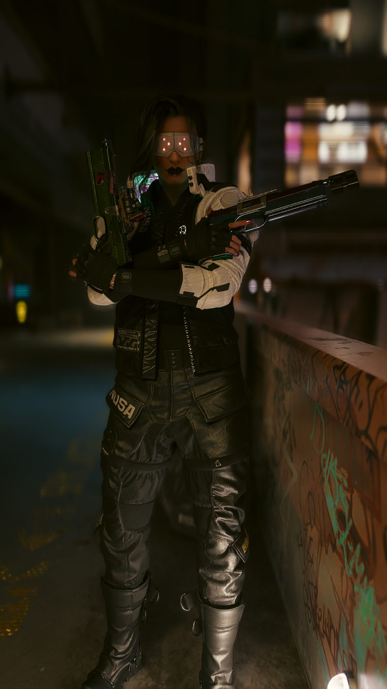
    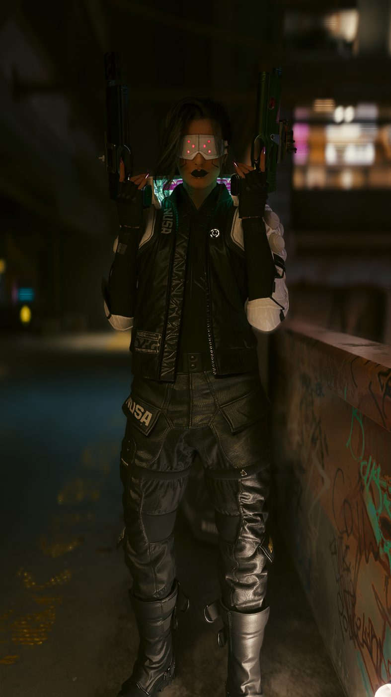
  </section>
  <section class="topic" v-show="active === 'all' || active === 'kojima'">
    <h3>Kojima</h3>
    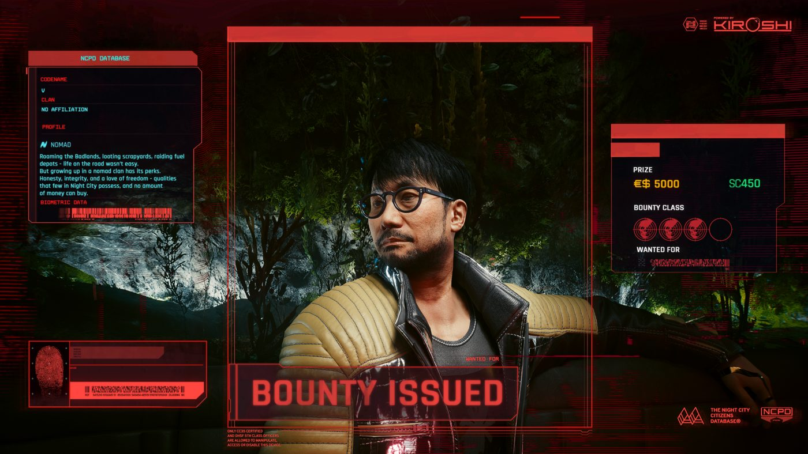
    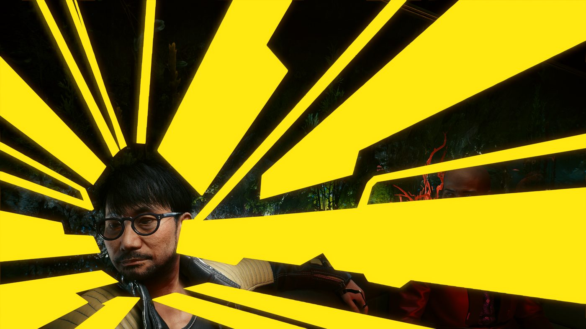
  </section>

  <template data-island>
    
  </template>

</is-land>
